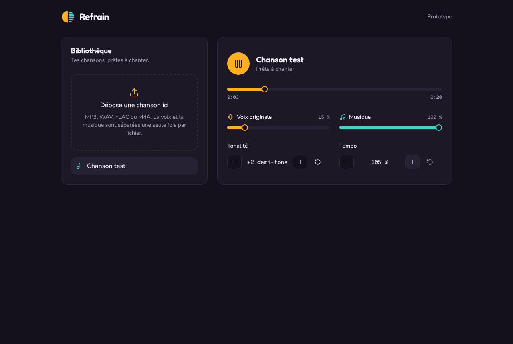

# Refrain

Karaoké maison : n'importe quelle chanson, avec la voix originale et la musique réglables séparément, la tonalité et le tempo ajustables.



## Comment ça marche

1. Tu déposes un fichier audio dans l'interface.
2. Le serveur le sépare **une seule fois** en deux pistes avec [Demucs](https://github.com/facebookresearch/demucs) (`htdemucs_ft`) : la voix, et tout le reste. Le résultat est mis en cache selon l'empreinte SHA-256 du fichier : renvoyer le même fichier ne relance rien.
3. Le navigateur charge les deux pistes et les joue ensemble avec la Web Audio API :

```
voix    → gain voix    ┐
                       ├→ SoundTouch (tonalité, AudioWorklet) → volume général → sortie
musique → gain musique ┘
```

Les deux sources démarrent sur la même horloge, elles restent donc synchronisées. Le tempo passe par `playbackRate` et SoundTouch corrige la hauteur.

## Structure

| Dossier   | Contenu |
|-----------|---------|
| `web/`    | Interface React + TypeScript + Vite, Tailwind v4, composants shadcn/ui (compatibles 21st.dev) |
| `server/` | API FastAPI + Demucs, stockage sur disque dans `server/data/` |

## Lancer en local

### Serveur

Python 3.10 ou plus et ffmpeg sont nécessaires.

```bash
cd server
python -m venv .venv && source .venv/bin/activate
# Sans GPU NVIDIA, installer d'abord PyTorch CPU (bien plus léger) :
# pip install torch torchaudio --index-url https://download.pytorch.org/whl/cpu
pip install -r requirements.txt
uvicorn refrain_server.main:app --reload --port 8000
```

Le premier morceau télécharge les poids du modèle (~300 Mo pour `htdemucs_ft`). Comptez quelques secondes par chanson sur GPU, plusieurs minutes sur CPU.

**Mode démo sans Demucs** : `REFRAIN_SEPARATOR=demo uvicorn refrain_server.main:app --port 8000` utilise l'astuce des vieux karaokés (annulation de phase gauche/droite via ffmpeg). Le son est médiocre mais l'interface se teste en quelques secondes, sans installer PyTorch : `pip install -r requirements-dev.txt` suffit.

| Variable                | Défaut                  | Rôle |
|-------------------------|-------------------------|------|
| `REFRAIN_DATA_DIR`      | `server/data`           | Fichiers originaux, pistes séparées, métadonnées |
| `REFRAIN_DEMUCS_MODEL`  | `htdemucs_ft`           | `htdemucs` est ~4x plus rapide, un peu moins propre |
| `REFRAIN_DEMUCS_DEVICE` | auto                    | `cuda`, `mps` ou `cpu` |
| `REFRAIN_SEPARATOR`     | `demucs`                | `demo` pour le mode sans Demucs |
| `REFRAIN_CORS_ORIGINS`  | `http://localhost:5173` | Origines autorisées, séparées par des virgules |

Tests : `pip install -r requirements-dev.txt && pytest`.

### Interface

Node 20 ou plus.

```bash
cd web
npm install
npm run dev
```

Ouvre http://localhost:5173. En développement, `/api` est redirigé vers le serveur sur le port 8000. Pour un serveur ailleurs, définir `VITE_API_URL` (ex. `https://api.exemple.fr`, sans slash final) au moment du build. `npm run build` produit `web/dist/`.

Pour ajouter des composants shadcn/ui ou 21st.dev : `npx shadcn@latest add <url ou nom>` depuis `web/` (le fichier `components.json` est prêt).

## Identité visuelle

Thème sombre par défaut, ambre pour la voix et sarcelle pour la musique (variables `--voice` et `--music` dans `web/src/index.css`). Polices : Fredoka pour le logo et les titres, Nunito pour l'interface, Geist Mono pour les chiffres.

## Feuille de route

- [x] Phase 1 : prototype, deux pistes, tonalité, tempo, séparation en cache
- [ ] Phase 2 : paroles synchronisées (LRCLIB + alignement WhisperX), bibliothèque SQLite
- [ ] Phase 3 : mode soirée, file d'attente des invités par QR code et WebSocket
- [ ] Phase 4 : version pour établissement

## Licences

SoundTouchJS est sous MPL-2.0, Demucs sous MIT. Les chansons et paroles restent soumises aux droits d'auteur : un usage public (bar, soirée payante) demande les licences adéquates (SACEM en France).
